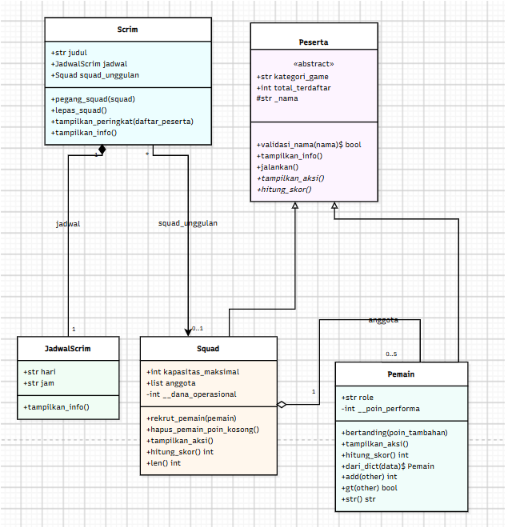

# Sistem Manajemen Scrim / Tournament PUBG Mobile (PBO - Python)

Program Python sederhana untuk mengelola peserta, pemain, squad, dan jadwal scrim PUBG Mobile. Proyek ini dibuat untuk memenuhi tugas PBO dengan menerapkan class dan object, encapsulation, inheritance, abstraksi, polimorfisme, serta relasi UML.

## Daftar Isi

- [Relasi UML](#relasi-uml)
- [Inheritance](#inheritance)
- [Empat Pilar PBO](#empat-pilar-pbo)
- [Penjelasan Class](#penjelasan-class)
  1. [Peserta, Pemain, Squad](#1-peserta-pemain-squad)
  2. [JadwalScrim](#2-jadwalscrim)
  3. [Scrim](#3-scrim)
- [Prinsip SOLID (Nilai Plus)](#prinsip-solid-nilai-plus)
- [Panduan Pengujian](#panduan-pengujian)
- [Screenshot Output Program](#screenshot-output-program)
- [Kesimpulan](#kesimpulan)
- [Alur Program (main)](#alur-program-main)

## Relasi UML



Class diagram menggambarkan lima class utama beserta atribut, method, dan relasi antarkelas pada program. Diagram cukup menampilkan nama class serta atribut dan method utama; tanda `+` berarti public, `#` protected, `-` private, sedangkan nama miring atau keterangan `«abstract»` menandakan abstract class.

Ringkasan relasi pada diagram:

```text
Peserta <|-- Pemain
Peserta <|-- Squad

Squad  o-- Pemain       (AGREGASI)
Scrim  *-- JadwalScrim  (KOMPOSISI)
Scrim  --  Squad        (ASOSIASI)
```

### Asosiasi
`Scrim.squad_unggulan` menyimpan referensi ke objek `Squad` yang sudah ada melalui `pegang_squad()`. Relasi ini merupakan asosiasi karena `Scrim` tidak membuat atau memiliki objek `Squad` tersebut secara eksklusif.

Contoh:

```python
scrim_malam.pegang_squad(squad_btr)
scrim_malam.lepas_squad()
```

### Agregasi
`Squad.anggota` berisi objek `Pemain` yang dibuat di luar `Squad`, kemudian dimasukkan melalui `rekrut_pemain()`. Relasi ini merupakan agregasi karena objek `Pemain` tetap dapat digunakan meskipun objek `Squad` yang menampungnya dihapus.

Contoh:

```python
squad_sementara = Squad("Evos Reborn")
squad_sementara.rekrut_pemain(pemain_microboy)

del squad_sementara
pemain_microboy.tampilkan_info()  # Pemain masih bisa dipakai
```

### Komposisi
`Scrim.jadwal` berisi objek `JadwalScrim` yang dibuat otomatis di dalam `Scrim.__init__()`. Relasi ini merupakan komposisi karena jadwal dibentuk sebagai bagian dari objek `Scrim` dan tidak disediakan sebagai objek terpisah oleh pemanggil konstruktor.

Contoh:

```python
scrim_kampus = Scrim("Scrim Kampus")
scrim_kampus.jadwal.tampilkan_info()

del scrim_kampus  # Referensi ke Scrim dan jadwalnya tidak lagi digunakan
```

`del scrim_kampus` menghapus referensi variabel ke objek `Scrim`; secara teknis, Python mengelola masa hidup objek melalui garbage collection. Jadi, contoh ini menunjukkan bahwa jadwal dibuat sebagai bagian dari `Scrim`, bukan jaminan bahwa memori objek langsung dibebaskan saat `del` dijalankan.

### Nama Class, Atribut, dan Method Utama

| Class | Keterangan | Atribut Utama | Method Utama |
|---|---|---|---|
| `Peserta` *(abstract)* | Class induk untuk Pemain dan Squad | `total_terdaftar`, `kategori_game`, `_nama` | `validasi_nama()`, `tampilkan_info()`, `jalankan()`, `tampilkan_aksi()`, `hitung_skor()` |
| `Pemain` | Merepresentasikan seorang pemain scrim | `role`, `__poin_performa` | `bertanding()`, `tampilkan_aksi()`, `hitung_skor()`, `dari_dict()` |
| `Squad` | Merepresentasikan tim yang terdiri dari beberapa pemain | `kapasitas_maksimal`, `anggota`, `__dana_operasional` | `rekrut_pemain()`, `hapus_pemain_poin_kosong()`, `tampilkan_aksi()`, `hitung_skor()` |
| `Scrim` | Merepresentasikan event scrim yang mempunyai jadwal dan dapat memegang sebuah squad | `judul`, `jadwal`, `squad_unggulan` | `pegang_squad()`, `lepas_squad()`, `tampilkan_peringkat()`, `tampilkan_info()` |
| `JadwalScrim` | Menyimpan hari dan jam pelaksanaan scrim | `hari`, `jam` | `tampilkan_info()` |

### Simbol dan Jumlah Objek pada Relasi

| Simbol | Jenis Relasi | Penjelasan |
|---|---|---|
| Segitiga kosong (▷) | **Inheritance (Pewarisan)** | `Pemain` dan `Squad` mewarisi atribut serta method dari `Peserta`. Ujung segitiga mengarah ke class induk. |
| Belah ketupat kosong (◇) | **Aggregation (Agregasi)** | Berada di sisi `Squad`, yang menampung objek `Pemain` melalui atribut `anggota`. |
| Belah ketupat penuh (◆) | **Composition (Komposisi)** | Berada di sisi `Scrim`, yang membuat objek `JadwalScrim` di dalam konstruktor. |
| Garis asosiasi (—) atau panah terbuka jika arah navigasi ditampilkan | **Association (Asosiasi)** | Menghubungkan `Scrim` dengan `Squad` melalui atribut `squad_unggulan`. |

Multiplicity atau angka pada ujung garis menunjukkan banyaknya objek yang dapat terhubung:

- **Squad–Pemain (Agregasi):** satu squad dapat memiliki 0 sampai 5 pemain, sesuai `kapasitas_maksimal`. Objek pemain dibuat secara terpisah dari squad.
- **Scrim–Squad (Asosiasi):** satu scrim dapat memegang 0 atau 1 squad. Satu squad dapat dirujuk oleh banyak scrim.
- **Scrim–JadwalScrim (Komposisi):** setiap objek scrim membuat tepat 1 objek `JadwalScrim` di konstruktornya.

## Inheritance

`Peserta` menjadi superclass yang diturunkan ke dua subclass, yaitu `Pemain` dan `Squad`. Keduanya memanggil `super().__init__(...)` di konstruktornya dan menambahkan atribut yang unik.

Contoh:

```python
class Pemain(Peserta):
    def __init__(self, nama, role, poin_awal=0):
        super().__init__(nama)
        self.role = role
        self.__poin_performa = max(0, poin_awal)
```

Method `tampilkan_aksi()` di-override oleh kedua subclass dengan perilaku berbeda.

Contoh:

```python
squad_btr.tampilkan_aksi()     # Menurunkan Squad ... ke arena
pemain_ryzen.tampilkan_aksi()  # Pemain ... sedang bertanding di arena
```

`Peserta._nama` merupakan atribut protected berdasarkan konvensi penamaan Python. Atribut ini dipakai langsung oleh subclass tanpa melalui property.

Contoh:

```python
print(f"Poin {pemain_ryzen._nama} setelah bertanding: {pemain_ryzen.poin_performa}")
```

## Empat Pilar PBO

Bagian ini menunjukkan kode pada `main.py` yang menerapkan empat pilar utama Pemrograman Berorientasi Objek (PBO).

### 1. Encapsulation (Enkapsulasi)

Enkapsulasi diterapkan dengan menyembunyikan data penting melalui atribut private, yaitu `__poin_performa` pada `Pemain` dan `__dana_operasional` pada `Squad`. Nilainya diakses atau diubah melalui `@property` dan setter. Setter menggunakan `max(0, nilai)` sehingga nilai negatif menjadi `0`.

Contoh pada `Pemain`:

```python
@property
def poin_performa(self):
    return self.__poin_performa

@poin_performa.setter
def poin_performa(self, nilai):
    self.__poin_performa = max(0, nilai)
```

Contoh pengujian pada `main.py`:

```python
pemain_ryzen.poin_performa = 6
pemain_ryzen.poin_performa = -10
print(pemain_ryzen.poin_performa)  # 0 setelah diberi nilai negatif
```

Prinsip yang sama dipakai pada property `dana_operasional` milik `Squad`. Atribut `_nama` menggunakan satu garis bawah dan dimaksudkan sebagai protected berdasarkan konvensi, bukan private.

### 2. Abstraction (Abstraksi)

`Peserta` merupakan abstract class karena mewarisi `ABC` dan memiliki dua abstract method, yaitu `tampilkan_aksi()` serta `hitung_skor()`. `Pemain` dan `Squad` mengimplementasikan kedua method tersebut. `Peserta` juga menyediakan method konkret `jalankan()` yang memanggil kedua method itu sehingga dapat digunakan oleh subclass.

Bagian utama pada `Peserta`:

```python
class Peserta(ABC):
    @abstractmethod
    def tampilkan_aksi(self):
        pass

    @abstractmethod
    def hitung_skor(self):
        pass

    def jalankan(self):
        self.tampilkan_aksi()
        print(f"Skor {self._nama}: {self.hitung_skor()}")
```

Bukti bahwa `Peserta` tidak dapat diinstansiasi secara langsung terdapat dalam pengujian `try-except` di `main.py`:

```python
try:
    peserta_langsung = Peserta("Anonim")
except TypeError as e:
    print(f"TypeError tertangkap: {e}")
```

Output yang diharapkan:

```text
Mencoba membuat objek langsung dari Peserta (abstract class)...
TypeError tertangkap: Can't instantiate abstract class Peserta without an implementation for abstract methods 'hitung_skor', 'tampilkan_aksi'
```

Pesan `TypeError` dapat berbeda sedikit menurut versi Python. Pengujian ini juga dijalankan oleh blok `main`.

### 3. Inheritance (Pewarisan)

`Pemain(Peserta)` dan `Squad(Peserta)` menggunakan `super().__init__(nama)` untuk menjalankan inisialisasi superclass. Setelah itu, masing-masing subclass menambahkan atribut sendiri: `Pemain` memiliki `role` dan `__poin_performa`, sedangkan `Squad` memiliki `anggota`, `kapasitas_maksimal`, dan `__dana_operasional`.

Contoh pada `Squad`:

```python
class Squad(Peserta):
    kapasitas_maksimal = 5

    def __init__(self, nama):
        super().__init__(nama)
        self.__dana_operasional = 0
        self.anggota = []
```

`Pemain` juga meng-override `tampilkan_info()` dan tetap memanggil implementasi induknya melalui `super().tampilkan_info()`.

### 4. Polymorphism (Polimorfisme)

Polimorfisme pada program ini diterapkan melalui overriding, duck typing, dan operator overloading.

**a. Overriding melalui pewarisan**

Method `tampilkan_aksi()` dan `hitung_skor()` memiliki implementasi berbeda pada `Pemain` dan `Squad`. Kedua jenis objek tersebut dipanggil dalam satu loop:

```python
for peserta in [pemain_ryzen, squad_btr, pemain_zuxxy]:
    peserta.tampilkan_aksi()
    print(f"  Skor: {peserta.hitung_skor()}")
```

**b. Duck typing**

`JadwalScrim` dan `Scrim` tidak berhubungan melalui inheritance, tetapi keduanya mempunyai method `tampilkan_info()`. Fungsi `cetak_info()` dapat memanggil keduanya tanpa memeriksa jenis objek.

```python
def cetak_info(objek):
    objek.tampilkan_info()

for objek in (jadwal_uji, scrim_malam):
    cetak_info(objek)
```

**c. Operator overloading**

Class `Pemain` mengimplementasikan `__str__()`, `__add__()`, dan `__gt__()`, sedangkan `Squad` mengimplementasikan `__len__()`.

```python
print(pemain_ryzen)                         # __str__
print(pemain_ryzen + pemain_zuxxy)          # __add__
print(pemain_ryzen > pemain_dari_data)       # __gt__
print(len(squad_btr))                        # __len__
```

Program tidak memakai rantai `if/elif` untuk membedakan perilaku berdasarkan `type()` atau nama jenis objek. Setiap class menjalankan perilakunya sendiri melalui method yang sesuai. `isinstance()` hanya digunakan dalam `validasi_nama()` untuk memeriksa tipe data input nama.

## Penjelasan Class

### 1. Peserta, Pemain, Squad

`Peserta` adalah cetak biru dasar untuk objek yang terdaftar di scrim.

| Anggota | Tipe | Keterangan |
|---|---|---|
| `total_terdaftar` | Atribut kelas (publik) | Menghitung jumlah objek yang berhasil dibuat melalui `Peserta` atau subclass-nya. |
| `kategori_game` | Atribut kelas (publik) | Nama game yang digunakan bersama, yaitu `PUBG MOBILE`. |
| `_nama` | Atribut instance (protected berdasarkan konvensi) | Divalidasi saat objek dibuat. |

Static method `validasi_nama()` memastikan nama berupa string dan tidak mengandung angka.

Contoh:

```python
Peserta.validasi_nama("Kairi")  # True
```

`Pemain(Peserta)` menambahkan `role` dan `__poin_performa` yang bersifat private. Property `poin_performa` menyediakan akses terkontrol ke poin. Class method `dari_dict()` adalah factory method yang membuat objek `Pemain` dari dictionary.

Contoh:

```python
pemain_dari_data = Pemain.dari_dict({"nama": "Kiboy", "role": "Sniper", "poin": 40})
```

`Squad(Peserta)` menambahkan `kapasitas_maksimal` sebagai atribut kelas, `__dana_operasional` sebagai atribut private melalui property, dan `anggota` sebagai list berisi objek `Pemain`.

Contoh:

```python
squad_btr.rekrut_pemain(pemain_ryzen)
squad_btr.hapus_pemain_poin_kosong()
```

### 2. JadwalScrim

`JadwalScrim` menyimpan hari dan jam pelaksanaan. Dalam program ini, objeknya dibuat secara otomatis oleh konstruktor `Scrim`.

Contoh:

```python
jadwal = JadwalScrim("Minggu", "19.00")
jadwal.tampilkan_info()
```

### 3. Scrim

`Scrim` merepresentasikan satu event scrim. Class ini membuat jadwalnya sendiri dan dapat menyimpan referensi ke satu squad unggulan.

Contoh:

```python
scrim_malam = Scrim("Scrim Malam Mingguan")
```

## Prinsip SOLID (Nilai Plus)

Contoh penerapan sederhana prinsip **Open/Closed Principle (OCP)** dan **Dependency Inversion Principle (DIP)** terdapat pada `Scrim.tampilkan_peringkat(daftar_peserta)`. Method ini menerima daftar objek dari luar dan menghitung peringkat melalui method `hitung_skor()`, tanpa perlu memeriksa apakah setiap objek merupakan `Pemain` atau `Squad`.

```python
def tampilkan_peringkat(self, daftar_peserta):
    urutan = sorted(daftar_peserta, key=lambda p: p.hitung_skor(), reverse=True)
    for no, peserta in enumerate(urutan, start=1):
        print(f"  #{no} {peserta._nama} - skor {peserta.hitung_skor()}")
```

Dengan pendekatan ini, subclass baru dari `Peserta` yang mengimplementasikan `hitung_skor()` dapat ikut diperingkat tanpa mengubah logika `tampilkan_peringkat()`. Ini merupakan contoh OCP, sekaligus pendekatan DIP sederhana karena logika peringkat bergantung pada perilaku bersama (`hitung_skor()`), bukan pada class konkret tertentu.

## Panduan Pengujian

**Cara menjalankan**

```bash
python main.py
```

Program menggunakan Python standar (3.10+) tanpa modul eksternal.

**Uji manual lain yang bisa dicoba**

- Rekrut lebih dari `Squad.kapasitas_maksimal` (5) pemain ke satu squad; pesan bahwa kapasitas maksimal tercapai akan muncul saat menambahkan pemain keenam.
- Buat objek `Pemain` dan `Squad`, lalu bandingkan hasil `tampilkan_aksi()` untuk melihat perbedaan overriding secara langsung.
- Coba membuat objek `Peserta` secara langsung dan pastikan `TypeError` tertangkap oleh `try-except`.
- Ubah `poin_performa` atau `dana_operasional` menjadi nilai negatif dan pastikan setter menahan nilainya di `0`.


## Alur Program (main)

Blok `if __name__ == "__main__":` menjalankan pengujian secara berurutan sebagai berikut:

1. **Uji class method:** membuat objek `Pemain` dari dictionary melalui `Pemain.dari_dict()`.
2. **Uji overriding dan instance method:** menjalankan aksi squad, menambah poin pemain melalui `bertanding()`, dan merekrut pemain ke squad.
3. **Uji abstraksi:** mencoba menginstansiasi `Peserta` dan menangkap `TypeError`; kemudian menjalankan method konkret `jalankan()` pada `Pemain` dan `Squad`.
4. **Uji polimorfisme melalui pewarisan:** memanggil `tampilkan_aksi()` dan `hitung_skor()` dalam satu loop yang berisi objek `Pemain` dan `Squad`.
5. **Uji duck typing:** memanggil `tampilkan_info()` milik `JadwalScrim` dan `Scrim` melalui fungsi `cetak_info()` yang sama.
6. **Uji operator overloading:** menguji `__str__()`, `__add__()`, `__gt__()`, dan `__len__()`.
7. **Uji asosiasi:** menghubungkan `Scrim` dengan `Squad` menggunakan `pegang_squad()`, lalu melepasnya melalui `lepas_squad()`.
8. **Uji agregasi:** menghapus objek squad sementara dan memastikan objek `Pemain` yang sebelumnya menjadi anggotanya masih dapat digunakan.
9. **Uji komposisi:** membuat objek `Scrim` dan menampilkan jadwal yang dibuat di dalamnya, kemudian menghapus referensi variabel scrim.
10. **Uji SOLID:** menampilkan peringkat pemain dan squad menggunakan method `tampilkan_peringkat()` yang sama.
11. **Uji setter:** memasukkan nilai valid dan nilai negatif pada `dana_operasional` serta `poin_performa`.
12. **Uji hapus item:** menghapus anggota squad yang mempunyai poin performa `0` melalui `hapus_pemain_poin_kosong()`.
13. **Uji static method dan validasi:** memeriksa nama valid melalui `Peserta.validasi_nama()` dan menangkap `ValueError` ketika nama mengandung angka.
